# Throughline

**A shared delivery workspace for product and engineering teams.**

Throughline keeps delivery progress, ownership, evidence, and the page-to-API map in one place. Teams can see what is ready, who is accountable, which frontend page depends on which backend contract, and what remains before a delivery milestone or release can be signed off.

[](LICENSE)
[](https://nodejs.org/)
[](CHANGELOG.md)

## Why Throughline

- **Team workspaces with real isolation** — Users can belong to multiple teams. Normal users only see projects belonging to their teams; team data is never exposed across tenants. Platform administrators can access all teams for operation.
- **Self-service onboarding** — Anyone can register, create a team, and share a ten-character invite code or invite link. Team owners can also add already-registered teammates by email.
- **Shared delivery visibility** — Every team member can see the team's projects and progress. Project roles still control who can submit, review, accept, or sign off.
- **Page & API mapping** — Every frontend page is a card carrying its access URL, a page screenshot, and the full set of backend endpoints it calls, each annotated with method, path, and purpose. Search across pages, endpoints, services, tables, and owners, or narrow by service, HTTP method, or screenshot coverage. Frontend and backend read the same card to agree on a contract; mappings can be edited or removed without touching project data.
- **End-to-end verification with live scope** — Each verification step is bound to the work items and page mappings it covers. A recorded pass keeps the fingerprint of its scope, so editing a linked acceptance standard or mapping flags the step as needing re-verification without erasing the earlier result. Recording a failure can open a tracked risk in the same action, pre-filled with the step note, an owner, a due date, and the linked items.
- **Two independent states per item** — Supply state and acceptance state are never collapsed into a single completion percentage.
- **Server-enforced gates** — Acceptance is unlocked by current-revision evidence, the latest effective technical review, and business confirmation where required. Hiding a UI button is never the control.
- **Revision-aware reviews** — Changing an acceptance standard increments the item revision and invalidates earlier reviews and acceptances without deleting history.
- **Conditions, risks, and assets** — Conditional acceptance requires an owner, due date, and severity. Risks have their own lifecycle; assets track verification and credential rotation.
- **Auditable by construction** — Item, risk, asset, verification, and project-stage changes are written to an append-only audit log.
- **Reports and sign-off** — Generate a scoped report, export Markdown, print to PDF, and collect role-based signatures bound to a canonical snapshot hash. Scope changes are detected as stale signatures.
- **Six interface languages** — English, Simplified Chinese, Japanese, Spanish, French, and German, with a persistent language selector.
- **Operational security** — scrypt password hashing, HttpOnly sessions, CSRF protection, server-side RBAC, session invalidation on password change, registration and login rate limits, and last-administrator protection.
- **Small footprint** — A single Node process and SQLite. Docker Compose and Caddy provide a production-ready HTTPS deployment.

No CDN, no third-party analytics, and no outbound telemetry.

## Screenshots

| Teams                                | Team workspace                               |
| ------------------------------------ | -------------------------------------------- |
| 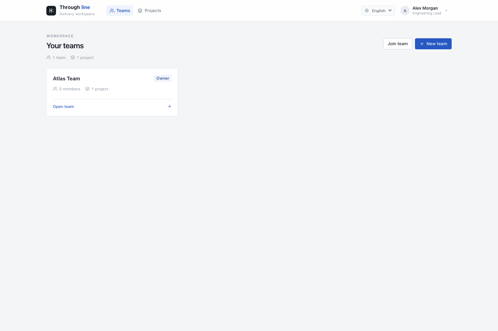 | 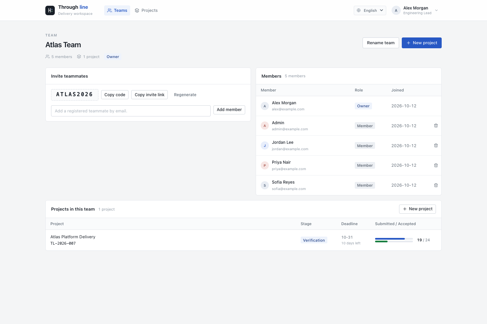 |

| Dashboard                                    | Work items                                |
| -------------------------------------------- | ----------------------------------------- |
| 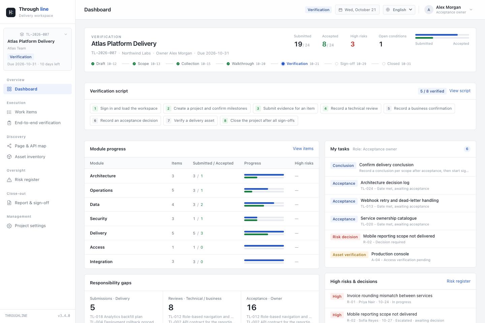 | 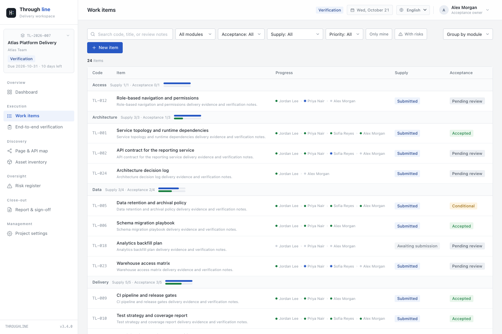 |

| Page & API map                                | Report and sign-off                                 |
| --------------------------------------------- | --------------------------------------------------- |
| 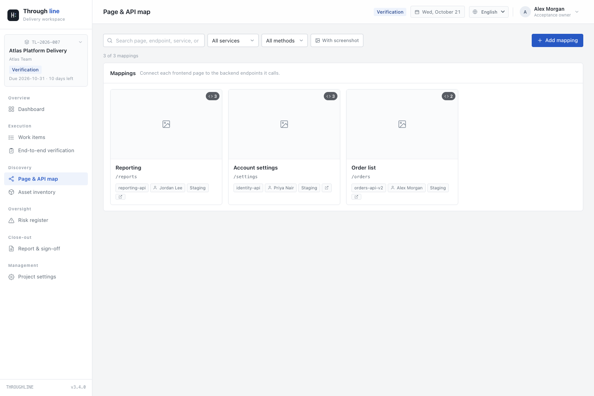 | 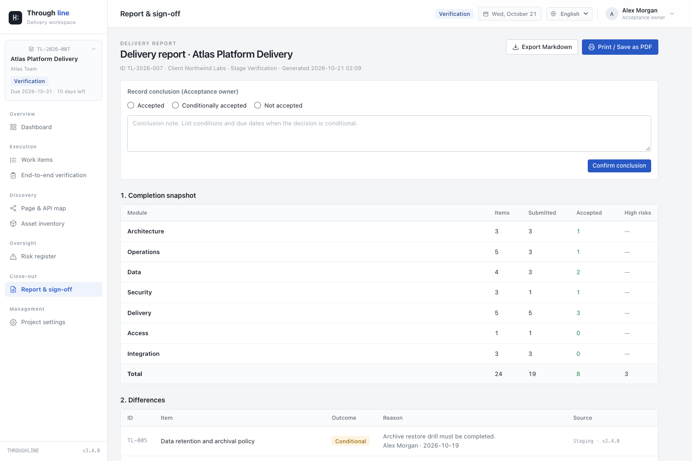 |

| Search and filter                                       | Mapping detail                                       | Add a mapping                                     |
| ------------------------------------------------------- | ---------------------------------------------------- | ------------------------------------------------- |
| 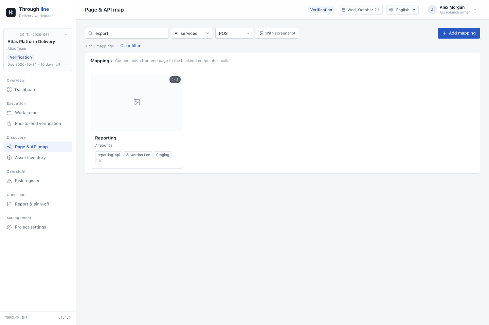 | 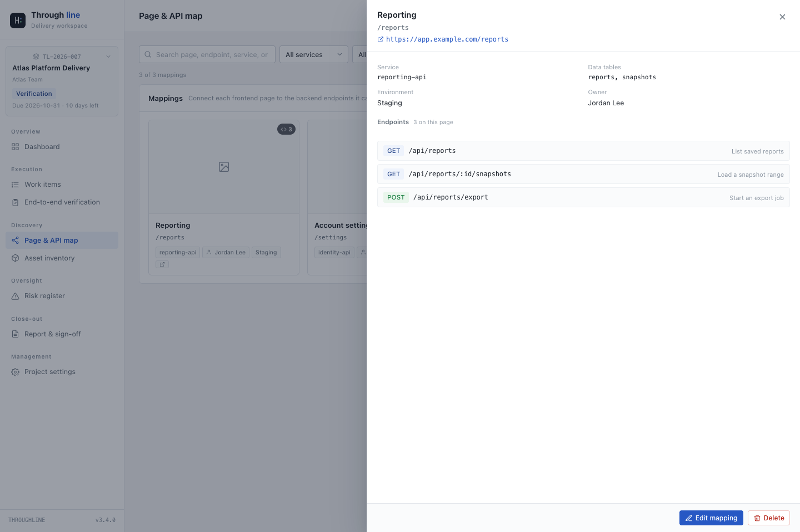 | 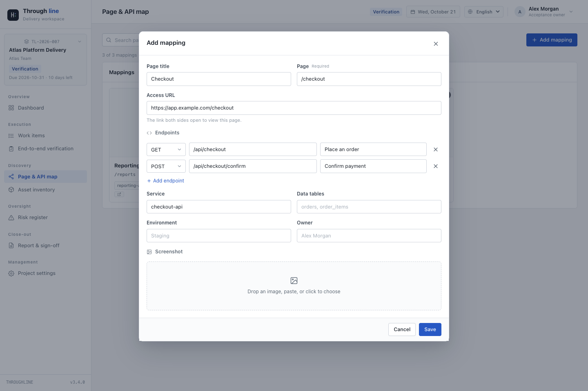 |

| End-to-end verification                                          | Verification scope                                            |
| ---------------------------------------------------------------- | ----------------------------------------------------------- |
| 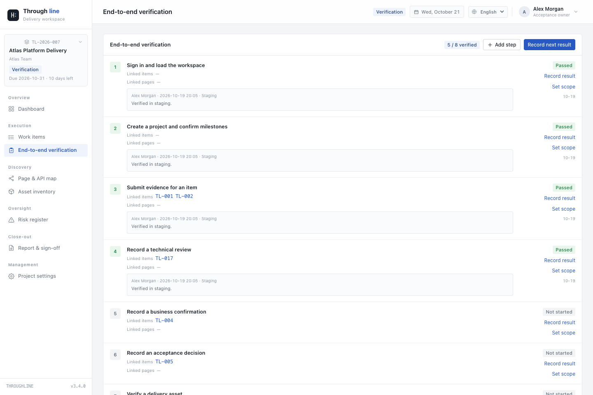 | 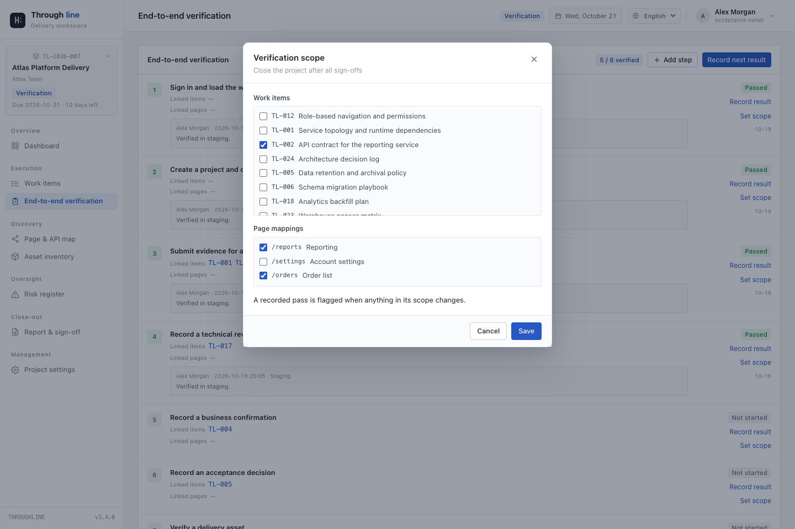 |

Screenshots show a synthetic sample workspace.

## Stack

| Layer            | Technology                                                                          |
| ---------------- | ----------------------------------------------------------------------------------- |
| Web              | React 19, TypeScript, React Router, TanStack Query, React Hook Form, Zod            |
| API              | Node.js 22, Express 5, express-session, Helmet, Pino, express-rate-limit            |
| Data             | SQLite (better-sqlite3), explicit migrations, WAL, foreign keys, append-only events |
| Shared contracts | `@throughline/shared`: domain enums, Zod validation, request/response types         |
| Tooling          | Vite, tsup, Vitest, Supertest, ESLint, Prettier                                     |
| Deployment       | Multi-stage Docker build, Docker Compose, Caddy 2                                   |

## Quick start

Requirements: Node.js **22+** and npm **10+**.

```bash
cp .env.example .env

# Set SESSION_SECRET for anything beyond local development:
# openssl rand -hex 48

# Set the first administrator (required on an empty database):
# BOOTSTRAP_ADMIN_NAME, BOOTSTRAP_ADMIN_EMAIL, BOOTSTRAP_ADMIN_PASSWORD

npm install
npm run dev
```

- Web: <http://localhost:5173>
- API health: <http://localhost:4000/api/health>

Vite proxies `/api` to port 4000 in development. In production, Express serves the built SPA directly.

The administrator can sign in with either the configured email address or the display name. After signing in, create a team, copy its invite link, and share it with the people who should join. New users can register from `/register`; `ALLOW_REGISTRATION=false` disables public sign-up for private deployments.

## Production deployment

### Docker Compose + Caddy

Requirements: a Linux host, Docker Engine 24+, Docker Compose v2, and a DNS record pointing at the host for automatic HTTPS.

```bash
cp .env.example .env
openssl rand -hex 48     # SESSION_SECRET
# Set APP_DOMAIN, BOOTSTRAP_ADMIN_EMAIL, and a strong BOOTSTRAP_ADMIN_PASSWORD
# Choose ALLOW_REGISTRATION=true for self-service teams, or false for invite-only operations

docker compose up -d --build
docker compose ps
curl -fsS https://your-domain.example/api/health
```

The Compose stack contains:

- `app` — a multi-stage production image running the Express API and serving the SPA. It listens on container port 4000 and is not exposed publicly. Data lives in the `throughline-data` volume.
- `caddy` — listens on 80/443, obtains and renews TLS certificates automatically, and proxies requests to `app:4000`.

If you use your own reverse proxy, set `TRUST_PROXY=1`, forward traffic to port 4000, and keep `APP_DOMAIN` in sync. The production session cookie uses the `__Host-` prefix and therefore requires HTTPS.

### Environment variables

| Variable                   | Default                        | Description                                                       |
| -------------------------- | ------------------------------ | ----------------------------------------------------------------- |
| `NODE_ENV`                 | `development`                  | Use `production` in production                                    |
| `PORT`                     | `4000`                         | Application port                                                  |
| `DATABASE_PATH`            | `./data/throughline.db`        | SQLite file path                                                  |
| `BACKUP_DIR`               | `backups/` beside the database | Backup output directory                                           |
| `SESSION_SECRET`           | development placeholder        | Required in production, at least 32 characters                    |
| `SESSION_TTL_DAYS`         | `7`                            | Session lifetime                                                  |
| `TRUST_PROXY`              | `0`                            | Set to `1` behind a trusted reverse proxy                         |
| `LOG_LEVEL`                | `info`                         | Pino log level                                                    |
| `BOOTSTRAP_ADMIN_NAME`     | `Administrator`                | First administrator display name                                  |
| `BOOTSTRAP_ADMIN_EMAIL`    | —                              | First administrator email                                         |
| `BOOTSTRAP_ADMIN_PASSWORD` | —                              | First administrator password; required when the database is empty |
| `ALLOW_REGISTRATION`       | `true`                         | Allow public self-registration                                    |
| `APP_DOMAIN`               | `localhost`                    | Domain used by the provided Caddy configuration                   |

The service refuses to start in production without a valid `SESSION_SECRET`. An empty database without bootstrap credentials also fails with a clear error rather than creating an insecure default account.

## Data and operations

SQLite is configured with WAL, foreign keys, a busy timeout, and explicit migrations. No external database service is required. Page screenshots are stored as BLOBs in the same file, so a single database backup captures the whole workspace.

### Backup

```bash
# From the host, in the project directory
docker compose exec -T app node scripts/backup.mjs
docker compose cp app:/app/data/backups/<file>.db ./backups/
```

Local development can use `npm run db:backup`. Schedule backups with cron and copy them to another host or object storage.

### Restore

```bash
docker compose stop app
docker compose cp ./backups/<file>.db app:/app/data/throughline.db
docker compose start app
```

Keep a copy of the current database before restoring. Migrations run automatically at startup.

### Upgrade

```bash
git pull
docker compose up -d --build
docker compose logs -f app
```

A single SQLite instance is appropriate for small and mid-sized teams. Horizontal scaling requires a server database such as PostgreSQL and a reviewed session/backup strategy.

## Security model

- Passwords are hashed with Node `scrypt` (N=32768, r=8, p=1) and a random salt; plaintext passwords are never logged.
- Sessions are stored in SQLite. Cookies are HttpOnly and SameSite=Lax; production uses the `__Host-` prefix and Secure.
- Every unsafe HTTP method requires a CSRF token, except the unauthenticated sign-in and registration endpoints.
- Permissions are computed server-side from team membership, project membership, and system role. Hidden UI controls are not a security boundary.
- **Tenant isolation:** normal users can only list and open projects that belong to a team they are a member of. Project member candidates are restricted to the project's team. Platform administrators are explicitly allowed to access all teams.
- Team owners can manage the team name, invite code, and membership. Project roles remain separate from team membership.
- Destroying a team membership also removes that user's project roles in the team's projects.
- Critical changes and audit events are written in the same transaction. There is no endpoint to rewrite or delete history.
- Helmet applies CSP, HSTS, and clickjacking protections. The API does not enable CORS.
- Sign-in, registration, and API traffic are rate-limited. Production requires an explicit session secret.
- Disabling an account invalidates all of its sessions. The last active administrator cannot be disabled or demoted.
- Assets store references to managed secret stores, never passwords, tokens, or identity documents.

**Scope boundaries:** this release stores structured evidence with references rather than binary uploads; email delivery is not built in (teams share invite links instead); and there is no built-in object storage. These are deliberate lightweight boundaries, not hidden limitations.

## Tests and quality

```bash
npm run typecheck   # shared, server, web
npm run lint        # ESLint
npm test            # Vitest + Supertest integration suite (22 tests)
npm run build       # tsup server + Vite web
```

The integration suite uses an in-memory SQLite database and covers:

- authentication, CSRF, logout, password rotation, and session invalidation
- registration, invite codes, owner invitations, code rotation, and team isolation
- multi-team membership and project access boundaries
- project creation, milestones, default verification steps, membership, and stage pause/resume
- role gates, evidence submission, business confirmation, and acceptance gates
- conditional acceptance, rejection and resubmission, and latest-review precedence
- acceptance-standard revisions and invalidation of historical decisions
- page/API mapping creation with several endpoints, validation, editing, deletion, screenshot upload, retrieval, and removal, and read-only access
- verification scope binding, cross-project link rejection, scope permissions, pass invalidation after a linked item or mapping change, and risk creation from a failed step
- reports, Markdown export, sign-off closure, stale snapshots, and reopening
- risk transitions, asset rotation, and end-to-end verification records
- user creation, deactivation, administrator permissions, and last-admin protection

CI runs in `.github/workflows/ci.yml`.

## Project layout

```text
apps/
  server/          Express API, SQLite migrations, sessions, domain rules, tests
  web/             React SPA, design system, business views
packages/
  shared/          Domain enums, Zod request schemas, shared TypeScript contracts
scripts/
  backup.mjs       Consistent SQLite backup
deploy/
  Caddyfile        Automatic HTTPS reverse-proxy example
docs/
  screenshots/     Product screenshots
PRODUCT.md         Product definition
DESIGN.md          Design system notes
```

### Domain notes

1. `domain/gate.ts` — evidence, the latest effective technical review, and business confirmation determine whether acceptance is available. After a revision, only current-revision records count.
2. `domain/snapshot.ts` — canonical hash for signatures. It excludes sign-offs themselves and the project stage, so closing a project does not invalidate signatures made moments earlier.
3. `services/report.ts` — report assembly, Markdown export, and snapshot state.
4. `services/projectLifecycle.ts` — stage transitions, automatic closure, pause, and reopening.
5. `data/teams.ts` and `data/projects.ts` — team membership, project visibility, and invitation codes.
6. Migrations live in `apps/server/src/db/migrations/`.

## API overview

| Area           | Example endpoints                                                                                                |
| -------------- | ---------------------------------------------------------------------------------------------------------------- |
| Session        | `POST /api/auth/register`, `POST /api/auth/login`, `GET /api/auth/me`, `POST /api/auth/logout`                   |
| Teams          | `GET/POST /api/teams`, `POST /api/teams/join`, `GET /api/teams/:id`, `/members`, `/join-code/rotate`             |
| Projects       | `GET/POST /api/projects`, `GET /api/projects/:id/overview`, `POST /api/projects/:id/stage`                       |
| Items          | `GET/POST /api/projects/:id/items`, `POST /api/items/:id/evidence`, `/reviews`, `/acceptance`                    |
| Discussions    | `POST /api/items/:id/notes`, `POST /api/notes/:id/answer`                                                        |
| Conditions     | `POST /api/conditions/:id/close`                                                                                 |
| Risks / assets | `GET/POST /api/projects/:id/risks`, `POST /api/risks/:id/transition`, `POST /api/assets/:id/action`              |
| Mappings       | `GET/POST /api/projects/:id/chains`, `PATCH/DELETE /api/chains/:id`, `PUT/GET/DELETE /api/chains/:id/screenshot` |
| Reports        | `GET /api/projects/:id/report`, `/report.md`, `POST /conclusion`, `POST /signoffs`                               |
| Administration | `GET/POST /api/users`, `PATCH /api/users/:id`                                                                    |

Errors share one shape: `{ "error": { "code", "message", "fields?", "requestId" } }`.

## Conventions

- The interface supports English, Simplified Chinese, Japanese, Spanish, French, and German through a persistent language selector. Identifiers, schema names, and API names are English.
- Dates are stored as `YYYY-MM-DD` or ISO 8601.
- Submission and acceptance are never merged. Conditions and risks must have an owner and a due date.
- No external fonts, icon packs, analytics scripts, or CDNs.

## Contributing

Issues and pull requests are welcome. Please read [CONTRIBUTING.md](CONTRIBUTING.md) and [CODE_OF_CONDUCT.md](CODE_OF_CONDUCT.md) before participating. Security reports should follow [SECURITY.md](SECURITY.md).

## License

Copyright © 2026 Throughline contributors.

Released under the [MIT License](LICENSE).
